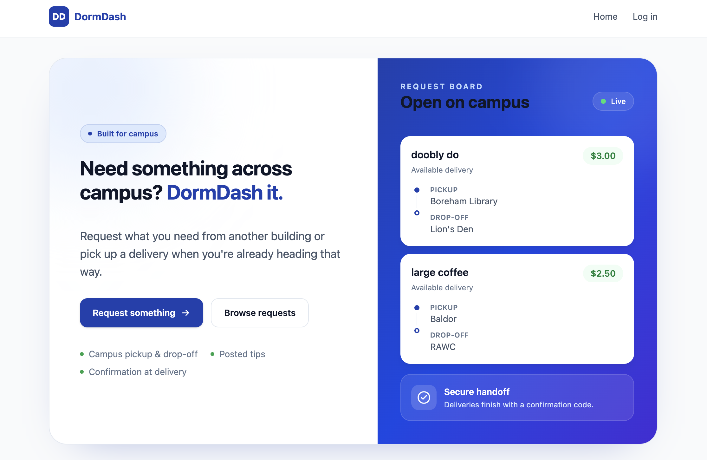

# DormDash

You forgot to get your backpack from your first class, but you're already in a different building for your next class. Another student on campus needs a bit of extra money and has some free time in between classes. DormDash solves exactly this problem -- a bridge between people needing errands run for them on campus, and students looking to make a buck or two.

The project is split into 2 major components: `WebUI/`, and `api/`. Both are containerized and can be ran in a Docker instance. Below is a step-by-step on how you can set up the project in your own environment:

1. Clone the repository to your local machine.
2. Install local dependencies inside both `WebUI/` and `api/` by running: `npm i`.
3. Create a `.env` inside `api/` and set MONGODB_URI to your own MongoDB cluster.
4. Inside the root, `DormDrop/`, run the program with docker: `docker compose up --build`. You can now use [https://localhost:8080](https://localhost:8080) to view the project and see your changes.

For more documentation on how the code works, visit our [Confluence page](https://uafs-crewly.atlassian.net/wiki/spaces/teamf69374d23a3f44bf9fcf775c054e30fa/overview?homepageId=9928813).

To view our tickets and current progress, visit our [Trello page](https://trello.com/b/1pChLJSJ/dormdash).